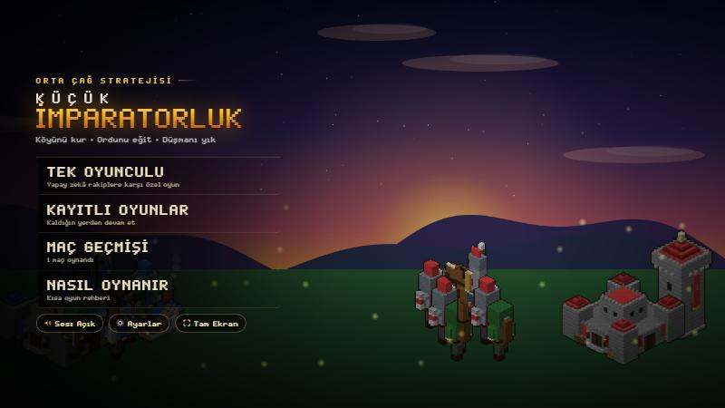
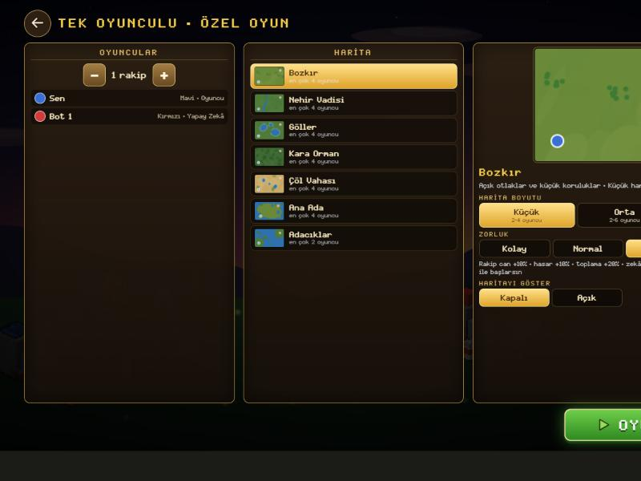
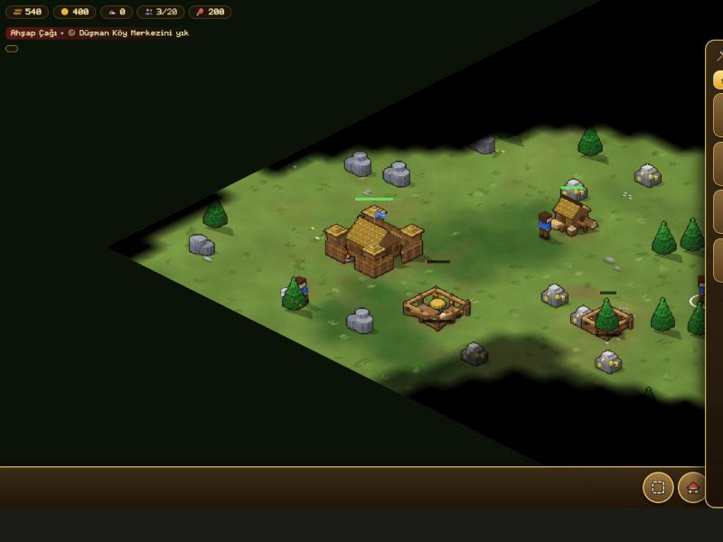
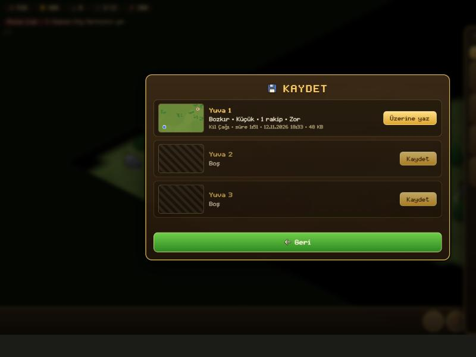
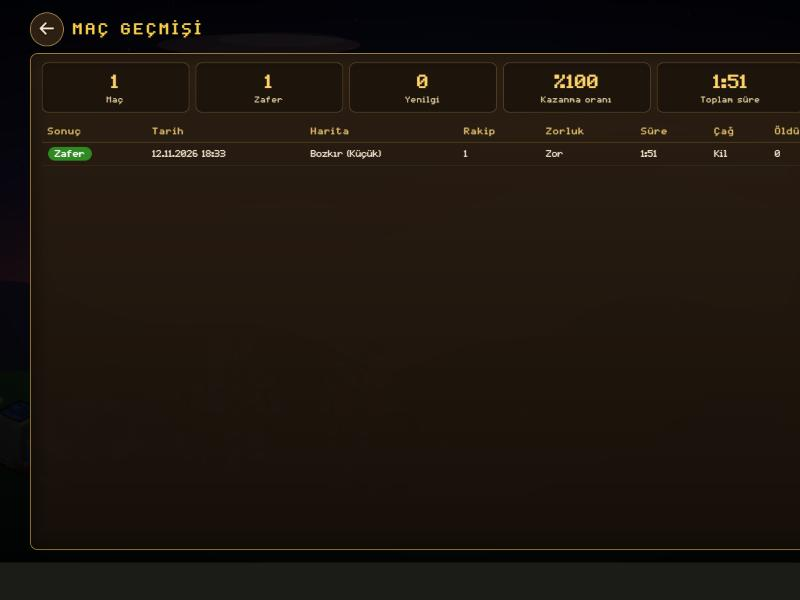

# Küçük İmparatorluk

Tarayıcıda oynanan, **React + Vite** ile yazılmış izometrik orta çağ strateji oyunu. Köyünü kur, kaynak topla, çağ atla, ordunu eğit ve yapay zeka rakiplerinin Köy Merkezini yık.

- **Canlı site:** https://imparatorluk-oyunu.vercel.app/
- **Depo:** https://github.com/tuncayorgundar/imparatorluk-Oyun


## Özellikler

- İzometrik gerçek zamanlı strateji: odun, altın, taş ve yiyecek ekonomisi
- 15 bina, 13 birim, 9 araştırma, 3 çağ (Ahşap, Kil, Taş)
- 10 harita türü, 3 harita boyutu, 1-8 yapay zeka rakip
- Kolay / Normal / Zor ve 19 ayarlı **Özel** zorluk
- **Giriş ekranı:** açılış animasyonundan sonra oyuncu adını ve sancağını seçer; her oyuncunun kayıtları ve maç geçmişi ayrıdır
- **Kayıt yuvaları:** 3 el ile kayıt + otomatik kayıt (30 saniyede bir ve sekme gizlenince)
- **Maç geçmişi:** her biten maç ve toplam istatistikler
- Kalıcı ayarlar (ses, müzik, mini harita) ve son kullanılan oyun kurulumu
- Cihaza göre kontrol: bilgisayarda fare (sol tık seç, sağ tık komut) ve klavye kısayolları, telefonda dokunmatik
- Bütün görseller kodla üretilir (voxel sprite motoru); müzik dışında resim/ses dosyası yoktur

## Ekran görüntüleri

| Giriş                                         | Ana menü                                            |
| --------------------------------------------- | --------------------------------------------------- |
|  |  |

| Oyun kurulumu                                     | Oyun                                        |
| ------------------------------------------------- | ------------------------------------------- |
|  |  |

| Kayıt yuvaları                                                  | Maç geçmişi                                               |
| --------------------------------------------------------------- | --------------------------------------------------------- |
|  |  |

## Kullanılan teknolojiler

| Katman                        | Teknoloji                                                                                                  |
| ----------------------------- | ---------------------------------------------------------------------------------------------------------- |
| Arayüz                        | **React 19** (fonksiyon bileşenleri, `useState`, `useEffect`, `useRef`, `useCallback`, `useMemo`, Context) |
| Derleme / geliştirme sunucusu | **Vite 8** (`npm create vite@latest`, `react` şablonu) + kendi yazdığımız küçük bir Vite eklentisi         |
| Stil                          | **Saf CSS** (CSS değişkenleri, flex, grid)                                                                 |
| Oyun motoru                   | Saf JavaScript, Canvas 2D, Web Audio API                                                                   |
| Veri saklama                  | **LocalStorage** (sürümlü şema)                                                                            |
| Test                          | Vitest (34 birim testi) + iki tarayıcı duman testi (giriş ve oyun akışı, girdi)                            |
| Kod kalitesi                  | oxlint, Prettier                                                                                           |
| Yayın                         | Vercel (`vercel.json`) ya da Netlify (`netlify.toml`)                                                      |
| Geliştirme ortamı (IDE)       | **Visual Studio Code**                                                                                     |
| Yapay zeka asistanı           | **Claude** (Claude Code)                                                                                   |

## Kurulum ve çalıştırma

Gereken: Node.js 20 veya üzeri.

```bash
git clone https://github.com/tuncayorgundar/imparatorluk-Oyunu.git
cd imparatorluk-Oyunu
npm install
npm run dev        # http://localhost:5173
```

Diğer komutlar:

```bash
npm run build      # dist/ klasörüne üretim derlemesi
npm run preview    # üretim derlemesini yerelde aç
npm test           # birim testleri (Vitest)
npm run lint       # oxlint
npm run format     # Prettier ile biçimlendir
```

Açılış animasyonunu atlamak için adrese `?nointro` ekleyebilirsin.

## Nasıl oynanır

Oyun girdi türünü her olayda tarayıcıdan okur (`pointerType`): fareyle masaüstü şeması, parmakla dokunmatik şeması çalışır. Dokunmatik ekranlı bir dizüstünde ikisi birlikte kullanılabilir. "Nasıl Oynanır" ekranı cihaza uygun kontrolleri gösterir.

**Bilgisayar (fare + klavye)**

| İşlem            | Kontrol                                                                                                      |
| ---------------- | ------------------------------------------------------------------------------------------------------------ |
| Seç              | Sol tık; sol tuşla sürükle: kutu seçim; Shift+tık: seçime ekle; çift tık: ekrandaki aynı tür                 |
| Komut ver        | Sağ tık: zemine yürü, düşmana saldır, kaynağı topla, inşaata yardım et, gemiye bin                           |
| İnşa et          | Köylü seç, İnşa (`B`) menüsünden bina seç, sol tıkla yerleştir (Shift: art arda); sağ tık ya da `Esc`: iptal |
| Toplanma noktası | Üretim binası seçiliyken sağ tık                                                                             |
| Kamera           | `W A S D` ya da ok tuşları; sağ ya da orta tuşla sürükle; tekerlek ya da `+` `-`; `H` köy merkezi            |
| Gruplar          | `Shift+1/2/3` kaydet; `1/2/3` çağır; `Q` tüm askerler; `E` tüm köylüler                                      |
| Duraklat         | `Esc` (önce süren işlemi ya da seçimi iptal eder) ya da sağ üstteki menü düğmesi                             |

**Telefon / tablet (dokunmatik, yatay)**

| İşlem     | Kontrol                                                                       |
| --------- | ----------------------------------------------------------------------------- |
| Seç       | Birime ya da binaya dokun; kutu seçim düğmesi ve parmakla alan çiz            |
| Komut ver | Birim seçiliyken hedefe dokun                                                 |
| İnşa et   | Köylü seç, İnşa menüsünden bina seç, yere dokun ya da gölgeyi sürükle, Onayla |
| Kamera    | Tek parmakla sürükle; iki parmakla yakınlaştır                                |
| Duraklat  | Sağ üstteki menü düğmesi                                                      |

Telefon dikey tutulursa oyun kendiliğinden yatay çizilir. Asker süvariyi, süvari okçuyu, okçu askeri yener. Bütün düşman Köy Merkezleri yıkılınca kazanırsın.

## Proje yapısı

```
imparatorluk-Oyunu/
├─ index.html
├─ vite.config.js            Vite ayarı + motor eklentisi (engineBundle)
├─ vercel.json, netlify.toml yayın ayarları
├─ public/                   müzik (mp3), uygulama ikonları, manifest
├─ docs/                     teslim belgesi, planlama, mimari, yapay zeka kullanımı, ekran görüntüleri
├─ tests/                    birim testleri (Vitest) + iki tarayıcı duman testi
└─ src/
   ├─ main.jsx, App.jsx      giriş noktası ve uygulama kabuğu (ekran yönetimi, oturum, otomatik kayıt)
   ├─ screens/               giriş, ana menü, kurulum, özel zorluk, kayıtlar, maç geçmişi, nasıl oynanır, ayarlar
   ├─ game/                  duraklatma menüsü, oyun sonu ekranı
   ├─ components/            Icon, MapPreview, MenuBackground, SaveSlotList, SettingToggles, SubScreen
   ├─ storage/               LocalStorage katmanı: local, profiles, settings, saves, history
   ├─ lib/                   biçimlendirme yardımcıları, dokunmatik cihaz algılama
   ├─ index.css              React ekranlarının stilleri
   └─ engine/                oyun motoru
      ├─ index.js            bootEngine(): motoru bir kez başlatır
      ├─ skeleton.js         motorun beklediği DOM iskeleti (canvas, HUD, alt menü)
      ├─ EngineContext.js    motor API'sini bileşenlere ulaştıran Context
      ├─ styles/             oyun içi stiller
      └─ parts/              motor kaynak dosyaları (ad sırasıyla tek modülde birleştirilir)
         └─ 90_api.js        motorun React'a açılan tek kapısı
```

Mimarinin ayrıntısı: [docs/MIMARI.md](docs/MIMARI.md)

## Veri saklama (LocalStorage)

Bütün anahtarlar `ki:` önekiyle yazılır. Cihaz ayarları ortaktır; kurulum, kayıtlar ve maç geçmişi her oyuncu için ayrıdır (`ki:p:<profil>:...`).

| Anahtar                     | İçerik                                                                                                |
| --------------------------- | ----------------------------------------------------------------------------------------------------- |
| `ki:profiles`               | Oyuncular: `{ version, current, list: [{ id, name, avatar, createdAt, lastSeen }] }` (en çok 6)       |
| `ki:settings`               | `{ sound, music, minimap }`                                                                           |
| `ki:p:<profil>:setup`       | Oyuncunun son kurulumu: `{ mapId, sizeId, opponents, difficulty, custom, revealMap }`                 |
| `ki:p:<profil>:saves`       | Kayıt dizini: `{ version, slots: { auto, 1, 2, 3 } }` (her yuva için harita, çağ, süre, tarih, boyut) |
| `ki:p:<profil>:save:<yuva>` | Oyun durumunun tamamı (birimler, binalar, harita, rakipler)                                           |
| `ki:p:<profil>:history`     | `{ version, matches: [...] }`: en yeni başta, en çok 50 maç                                           |

Kayıt dizini ile kayıt verisi ayrı tutulur: liste ekranı yalnız küçük dizini okur. Bozuk ya da farklı sürümden kalan veri uygulamayı çökertmez; kullanıcıya bildirilir.

Girişte şifre yoktur: sunucu olmadığı için tarayıcıda saklanan bir şifre gerçek koruma sağlamaz. Giriş, aynı cihazı paylaşan oyuncuların ilerlemesini birbirinden ayırır.

## Yapay zeka kullanımı

Proje **Visual Studio Code** içinde, **Claude Code**'dan yardım alınarak geliştirildi.

| Aşama                 | Yapay zeka nasıl kullanıldı                                                 |
| --------------------- | --------------------------------------------------------------------------- |
| Planlama              | Uygulamanın fikri, ekranları ve veri modeli birlikte planlandı              |
| Bileşen üretimi       | React ekranları ve bileşenleri, LocalStorage katmanı, oyun motorunun API'si |
| Hata ayıklama         | Hataların kök nedeninin bulunması ve düzeltilmesi                           |
| Kod açıklama          | Uygulama yapısının ve veri katmanının açıklanması                           |
| Stil önerileri        | Ekran tasarımları, bilgisayar ve telefona göre düzen                        |
| Optimizasyon          | Performans ölçümü ve iyileştirme                                            |
| Test ve dokümantasyon | Birim ve tarayıcı testleri, README ve proje belgeleri                       |

Yapay zekanın ürettiği kod; derleme, kod denetimi ve testlerle kontrol edilerek projeye alındı. Ayrıntılar ve örnek istemler: [docs/YAPAY_ZEKA.md](docs/YAPAY_ZEKA.md)

## Yayınlama

Proje **Vercel**'de yayında: https://imparatorluk-oyunu.vercel.app/ (`main` dalına her gönderimde yeniden derlenir).

**Vercel:** depoyu Vercel'e bağla; çatı "Vite" olarak algılanır; Deploy. (`vercel.json` hazır.)
**Netlify:** "Add new site", "Import from Git"; build komutu `npm run build`, yayın klasörü `dist`. (`netlify.toml` hazır.)

Site tamamen statiktir; sunucu gerekmez.

## Gelecek planları

- Çok oyunculu mod (ayrı bir sunucu gerektirdiği için bu sürüme alınmadı)
